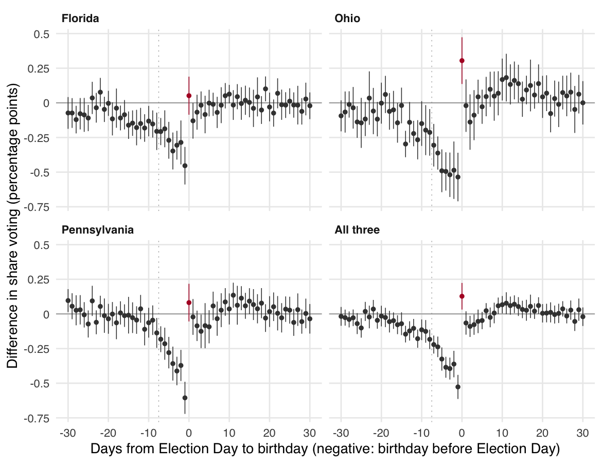

# Birthday Voter: How Birthdays Near Election Day Change Whether and How People Vote

Jake Leland and Gaurav Sood

[Paper](ms/main.pdf) · [Data sources](docs/sources.csv)

## Question and motivation

If people vote out of a sense of duty and like doing dutiful things on their birthdays, an Election Day birthday
should raise turnout. If a birthday competes with voting for time, it should lower turnout or move votes to other
days. Comparing the two tells us something about why people vote and how they fit voting into their lives.

## Data and research design

Voter files from Florida (2006–2020), Ohio (2000–2016), and Pennsylvania (2009–2024) record each registrant's date
of birth and whether they voted in 76 statewide elections, 550 million registrant-elections in all; Florida and
Pennsylvania also record how. Election dates move from year to year, so the same birth date falls on or near
Election Day in some years and not others. We compare people born on the same calendar date in the same state across
those years, with fixed effects for birth date by state and election type and for election by birth year, and
estimate turnout for each day from 30 days before to 30 days after Election Day. Standard errors are clustered by
calendar birth date.

## Key findings

A birthday in the days before Election Day lowers turnout, by about half a percentage point when it is the day
before, in all three states. The loss is in voting in person. An Election Day birthday changes turnout little:
people who would have voted at the polls vote early or by mail instead. The pattern was first seen in Florida's
2006–2016 elections and recurs in the elections that were not used to find it.



Each point is the difference in turnout between a birthday that many days from Election Day and a birthday more
than 30 days away, among people born on the same date in the same state and type of election; bars are 95%
confidence intervals.

## Reproduce

```
make restore
make check
```

`make check` rebuilds the analysis from the committed cell counts in `data/cells/`, compiles the manuscript, lints
the R code, and runs the tests; it does not need the voter files. Every number in the text comes from `tabs/macros.tex`, which `scripts/04_tables.R`
writes. Use R 4.6; the manuscript needs XeLaTeX and latexmk. `make ci-docker` runs the checks in the project's
standard Rocker image.

Rebuilding the cells needs the restricted voter files from the Harvard Dataverse (Florida
[doi:10.7910/DVN/UBIG3F](https://doi.org/10.7910/DVN/UBIG3F), Ohio
[doi:10.7910/DVN/9KX752](https://doi.org/10.7910/DVN/9KX752), Pennsylvania
[doi:10.7910/DVN/MNDSVD](https://doi.org/10.7910/DVN/MNDSVD)), a Dataverse API token in
`~/.config/dataverse/token` or `DATAVERSE_API_TOKEN`, and 7-Zip: `make cells STATE=FL EXTRACT=2017`. Source files are kept
outside the repository, under `BIRTHDAY_VOTER_SOURCE` (default `/Volumes/Staging/birthday_voter`).

## Files and pipeline

| Path | Contents |
|---|---|
| `docs/sources.csv` | Dataverse file ids and the MD5 checksums downloads are verified against |
| `docs/elections.csv`, `docs/extracts.csv` | Statewide elections studied, and which extract each is taken from |
| `docs/history_codes.csv` | What each voter-history code means, from the state's file layout |
| `docs/official_turnout.csv` | Official turnout, for checking levels |
| `data/cells/` | Registrants and votes by election and exact date of birth, plus diagnostics; no names or IDs. Rebuilt from the archived sources byte for byte |
| `R/` | Download, cell-building, calendar, estimation, and output functions |
| `scripts/` | Configuration and numbered stages, below |
| `tests/testthat/` | Calendar rules, estimator equivalence, reconciliation with earlier counts, and number provenance |
| `ms/` | `main.tex`, `references.bib`, and the compiled `main.pdf` |

| Stage | Purpose |
|---|---|
| `scripts/00_config.R` | Paths, settings, labels, and figure and table style |
| `scripts/00_fetch.R` | Download and verify the restricted files |
| `scripts/01_build_cells.R` | Count registrants and votes by election and date of birth with DuckDB (`R/cells_{fl,oh,pa}.R`) |
| `scripts/02_estimate.R` | Estimate effects and write `tabs/*.csv` |
| `scripts/03_figures.R` | Write `figs/` |
| `scripts/04_tables.R` | Write LaTeX tables and `tabs/macros.tex` |
| `scripts/99_run_all.R` | Run stages 02–04 |
